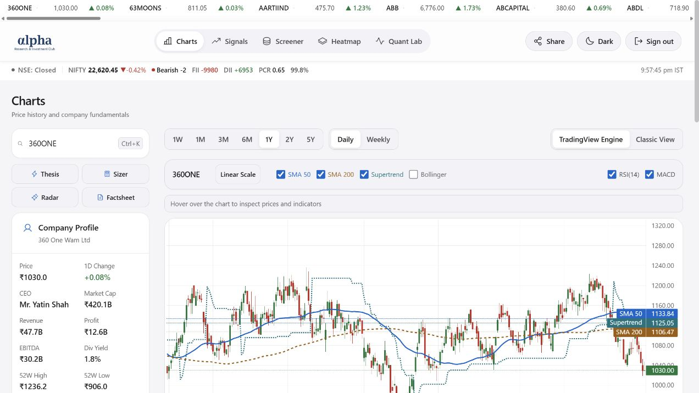

# Quantitative Stock Analysis System for NSE — Windows 10 & 11

    

---

quant-alpha is a research-backed quantitative stock analysis system for the National Stock Exchange of India, combining price data, financial statements, technical indicators, and recorded factor snapshots into a unified analysis engine. The platform delivers sector-relative scoring across value, quality, momentum, and volatility factors, along with forensic warnings and ATR-based trade-planning and position-sizing tools. Portfolio analysis covers Max Sharpe, minimum volatility, risk parity, and measured efficient-frontier estimates, while a backtest studio evaluates short- and long-horizon price-factor proxies with NIFTY benchmarks, turnover costs, and gap-aware stops. A strategy builder replays recorded factor snapshots with configurable weighting rules, ATR stops, and take-profit exits, and a shared research account gates Signals and Quant Lab behind server-validated sessions.

## Features

- **NSE universe screening:** Surfaces a tradeable universe ranked by traded value rather than alphabetically, filtered against configurable coverage requirements so that stocks with insufficient data are excluded before scoring rather than penalized silently.

- **Versioned multi-factor scoring:** Produces short- and long-term composite scores from sector-relative value, quality, momentum, trend, and stability factors, each with explicit weights and sector-relative comparisons. Financial-sector issuers are evaluated using accounting measures appropriate to their reporting structure.

- **Immutable recommendation history:** Every daily recommendation persists its model version, input factors, and data coverage at generation time. Historical scores are never recomputed against a revised model, so prior signals remain reproducible and auditable.

- **Technical indicators and trade planning:** Computes standard price-derived indicators and derives ATR-based trade plans with position-sizing outputs, including gap-aware stop handling for close-triggered exits.

- **Forensic and risk flags:** Applies forensic screening rules to surface accounting anomalies and stability concerns alongside standard factor scores, with unavailable metrics marked explicitly as not applicable.

- **Portfolio construction tools:** Implements Max Sharpe, minimum volatility, and risk parity allocation, with measured efficient-frontier estimates, correlation matrices, and factor information coefficients computed from daily cross-sectional rank correlations over a calendar quarter.

- **Backtest studio:** Runs short- and long-window price-factor proxy backtests holding shares between scheduled rebalances, charging per-leg turnover costs, tracking NIFTY benchmark prices, and marking runs unavailable rather than publishing partial results when held-stock execution prices are missing.

- **Strategy builder:** Replays recorded factor snapshots with configurable presets and weighting rules, ATR stops, and take-profit exits. Candidate sets with no qualifying stocks resolve to cash, and historical periods without snapshot coverage are never synthesized.

- **Live quote integration:** Streams daily and weekly price history with quotes refreshing on a fixed cadence during and outside trading hours, gated by an exchange holiday calendar and served through stable cached requests.

- **Interface consistency:** Applies a shared typographic, color, and control system across all screens, with matching light and dark hierarchies, keyboard-navigable dialogs with focus restoration, and respect for reduced-motion and reduced-transparency preferences.

- **Managed session layer:** Server-validated sessions gate research and portfolio surfaces while public charting and screener views remain accessible without authentication; credentials are never exposed to browser code.

- **Local persistence and validation:** Stores market scans and factor history in a joined SQLite database with checkpointed write-ahead logging, content-addressed backtest caches invalidated on source-price changes, and a regression suite covering session handling, authorization, pagination, and strategy execution.

## How It Works

quant-alpha operates as a layered research pipeline that transforms raw exchange data into ranked, reproducible analysis. Each stage is independently inspectable, and every output can be traced back to the inputs and model version that produced it.

- **Data ingestion and persistence:** Price history, financial statements, and corporate actions are pulled for the tracked NSE universe and persisted to a local SQLite store. The universe is selected by traded value rather than alphabetically, so coverage reflects actual market activity. Ingestion timestamps are preserved across runs, allowing downstream stages to reuse cached acquisitions when the underlying data has not changed.

- **Factor computation:** Sector-relative value, quality, momentum, and volatility factors are computed per security, with sector-appropriate accounting measures applied to financial companies. Technical indicators, including ATR, are derived from the same price series used for scoring, keeping signals and trade plans internally consistent. Coverage requirements gate each factor so that insufficient data produces an explicit N/A rather than an imputed value.

- **Versioned scoring and signals:** Quality, value, momentum, trend, and stability are combined under a documented, versioned weighting specification. Short- and long-term horizons carry explicit weights, and the screener and signal views consume the same horizon-specific score so recommendations never diverge between interfaces. Every daily recommendation retains its model version, inputs, and coverage in an immutable history; prior model probabilities are never reused. The top picks list may legitimately return empty when no stock clears the qualification threshold.

- **Portfolio and quantitative analysis:** Max Sharpe, minimum volatility, and risk parity allocations are computed alongside measured efficient-frontier estimates, correlation matrices, and factor information coefficients. Factor IC is measured through daily cross-sectional Spearman correlations over a calendar quarter, with insufficient samples surfacing as N/A. Macro stress cards apply explicit illustrative shock assumptions rather than implied forecasts.

- **Backtest and strategy replay:** Price-factor proxies are evaluated across 1Y and 6M windows against a benchmark, holding shares between rebalances, charging turnover costs of 20 basis points per leg, and applying close-triggered stops that include gap losses. The strategy builder replays recorded factor snapshots with configurable weighting rules, ATR stops, and take-profit exits, emitting a full trade log. No matching stocks default to cash, and unavailable historical periods are never synthesized.

- **Validation and reproducibility:** Backtest caches are versioned and invalidated whenever their source-price fingerprint changes. Missing benchmark coverage or absent held-stock execution prices cause the affected run to be marked unavailable rather than producing partial or invented performance. The archived factor history begins at a fixed date, and price-factor backtests are explicitly labeled as proxies rather than replays of the current fundamental model.

- **Access and interface layer:** Charts and the public screener remain available without authentication, while signals and portfolio tools require a validated session. Market quotes refresh on a fixed cadence during trading hours and a slower cadence when closed, governed by a holiday calendar, using stable cached requests to avoid redundant acquisition.

## Compatibility & Requirements

quant-alpha runs on **Python 3.12** and **Node.js 24**. The analysis engine and data pipeline target Python 3.12 with a dedicated virtual environment; the frontend is a React 19 and TypeScript 6 application built with Vite and requires Node.js 24 for both development and production builds.

**Desktop platforms.** Development is supported on Windows (PowerShell examples in project documentation), macOS, and Linux. Python commands must be invoked through the project virtual environment rather than a system interpreter. SQLite is used for local market-scan storage, so no external database server is required.

**Runtime dependencies.**
- Python 3.12 with the packages pinned in the project requirements file, plus pytest for validation runs.
- Node.js 24 with npm for dependency installation and script execution.
- A local SQLite database assembled from tracked chunk files before any database-backed script is run.

**Market data and connectivity.** The scanner and quote-repair scripts make external requests to exchange data sources and therefore require an active internet connection during scan and backfill operations. The dashboard serves cached research data locally through the Vite development server; live quote refresh behavior follows the NSE trading calendar and holiday schedule bundled with the project.

**Browser requirements.** The dashboard targets current evergreen browsers with support for modern JavaScript, CSS custom properties, and native system typography. Light and dark themes, reduced-motion preferences, and reduced-transparency preferences are respected where the browser exposes them.

**Hosted deployment configuration.** Production deployment uses Vite with the `frontend` root directory, `npm run build` as the build command, and `dist` as the output directory on Node.js 24.x. Session-protected research views require the shared account credentials and an optional signing secret to be configured as server-side environment variables; credentials must never be exposed with a public browser prefix. Without the required login settings, shared login fails closed while public charts and the screener remain available.

**Authentication and session behavior.** Sessions use signed, HttpOnly, SameSite=Strict cookies, expire after eight hours, and are marked Secure in production. The login throttle is process-local; distributed rate limiting must be enforced at the hosting platform's firewall layer if required. Browser local-storage flags do not grant access to protected resources.

**Data packaging constraints.** Research datasets are excluded from the static build output and are served only through the server-side data function, which resolves files relative to its own module path. A successful browser build alone does not validate the serverless function compiler configuration, so deployment checks must verify both.

**Operational limits.** The archived factor history begins at a fixed date and is not a complete historical index-constituent record. Backtests over unavailable periods are reported as unavailable rather than synthesized, and missing benchmark coverage or held-stock execution prices cannot produce invented returns. The bundled NSE market calendar requires periodic refresh for years beyond its covered range.

## FAQ

**Is quant-alpha affiliated with any exchange or broker?**
No. quant-alpha is an independent research system. It ingests publicly available NSE price and financial data and records its own factor snapshots. It does not place orders, connect to broker accounts, or maintain any relationship with the National Stock Exchange. All outputs are generated locally from the tracked datasets in the project.

**Which universe does the screener cover?**
The tracked universe is selected by traded value rather than alphabetically, so it reflects actively traded names rather than a full index-constituent database. Historical coverage is limited to what has been recorded in the factor archive; the system does not synthesize prices or fundamentals for periods it did not observe. Stocks that drop out of the current screen are still refreshed while held in a research portfolio, provided the exchange's daily file remains available.

**How are scores and recommendations kept consistent?**
The versioned ranking combines quality, value, momentum, trend, and stability with explicit weights, sector-relative comparisons, and minimum data-coverage requirements. Financial companies are evaluated with accounting measures appropriate to their statements. Signals and the Screener draw from the same horizon-specific score, so a stock's recommendation does not diverge between views. When no stock clears the thresholds, top picks are returned empty rather than padded.

**Why does a score sometimes display N/A?**
Missing inputs are never imputed silently. If sector peers, factor history, or benchmark coverage are insufficient for a given window, the affected field is marked N/A. Factor information coefficients use daily cross-sectional Spearman correlations over a calendar quarter and require a minimum sample before reporting. Similarly, a backtest with an unavailable held-stock execution price is flagged with the ticker and date instead of publishing partial performance.

**What is the difference between backtests and recorded strategy replay?**
Price-factor backtests are proxies: they apply short- and long-term price factors across 1Y and 6M windows with NIFTY benchmark prices, shares held between rebalances, turnover costs, and close-triggered stops that include gap losses. They are not historical replays of today's fundamental model. The strategy builder, by contrast, replays recorded factor snapshots with selectable weighting rules, ATR stops, take-profit exits, and trade logs. Rebalances charge 20 basis points per leg and liquidate/re-enter at scheduled intervals. Neither mode forecasts returns.

**How current are quotes and how are they cached?**
Live quotes refresh every 30 seconds during trading hours and every five minutes when the market is closed, governed by the bundled NSE holiday calendar. Requests use stable cached access so repeated views do not multiply upstream calls, and acquisition timestamps are preserved across automated runs. Generated research commits are rebased before publication, and concurrency controls prevent overlapping scans from publishing competing datasets.

**What happens when market data acquisition fails?**
A missing bundled file or malformed payload surfaces as a 503 from the data endpoint; the function logs identify which resource failed. Generation errors outside that path fail the automated job rather than emitting degraded research. Cache invalidation is keyed to source-price fingerprints, so corrected backtest caches are versioned and regenerated when their underlying prices change.

**Does the local database need special handling?**
Yes. The joined SQLite database is local-only and ignored by version control. The repository tracks fixed-size chunks that must be joined before running database scripts and split again before committing, with SQLite WAL writes checkpointed first. An installed pre-commit hook may perform the split automatically, so the joined copy should be kept current after pulling new parts to avoid overwriting fresher chunks with a stale local copy. Activate the virtual environment before committing if the hook invokes Python.

**Which runtime versions are supported?**
Python 3.12 and Node.js 24 are the validated targets for the engine and frontend respectively. Python commands should run through the project virtual environment. The frontend build type-checks both the browser projects and the standalone function configuration before bundling, and the test suite covers sessions, authorization, packaged data paths, pagination, and strategy execution.

**Are the portfolio tools predictive?**
No. Max Sharpe, minimum volatility, risk parity, efficient-frontier estimates, correlations, and macro stress cards are research instruments built on explicit, documented assumptions. Stress cards in particular use illustrative shock parameters. Outputs are intended for educational study of factor behavior and portfolio construction, not as forecasts or allocation guidance.

## Disclaimer

`quant-alpha` is a research and educational tool for quantitative analysis of National Stock Exchange of India equities. It is provided "as is" and "as available," without warranties of any kind, whether express, implied, or statutory, including but not limited to warranties of merchantability, fitness for a particular purpose, accuracy, and non-infringement.

Nothing produced by this software constitutes investment advice, a recommendation, a solicitation, or an offer to buy or sell any security. Scores, signals, rankings, forensic warnings, portfolio estimates, efficient-frontier projections, backtest results, strategy-builder outputs, and macro stress cards are the product of documented models applied to historical and snapshot data. They are research artifacts, not forecasts, and they carry no guarantee of future performance. Model weights are a documented starting specification; optimality is not claimed, and outcomes will vary with data coverage, market regime, and input assumptions.

The system depends on third-party market data and financial statements whose completeness, timeliness, and correctness are outside its control. Missing benchmark coverage, absent execution prices, unavailable historical periods, or stale quotes are surfaced as N/A or as unavailable results rather than synthesized values. Backtests are proxies, not historical replays of the current fundamental model, and the recorded universe is not a complete historical index-constituent database. Reported figures, including those incorporating illustrative shock assumptions or per-leg transaction costs, should be independently validated before any use.

Users are solely responsible for how they interpret and act on any output, for verifying data against authoritative sources, and for compliance with applicable laws and regulations governing securities research and trading in their jurisdiction. The authors and maintainers accept no liability for any direct, indirect, incidental, consequential, or special loss or damage arising from the use of, or reliance on, this software or its outputs. Use of the software is governed by the terms of its license.

## License

quant-alpha is distributed under the Apache License 2.0 with the Commons Clause condition. The license grants a worldwide, royalty-free, non-exclusive copyright and patent license to use, reproduce, modify, and distribute the software in source or object form, subject to the terms and conditions of the Apache License 2.0.

The Commons Clause restriction applies: you may not sell, sublicense for a fee, or otherwise commercialize the software or any derivative work whose value derives substantially from the functionality of quant-alpha. Internal research, academic use, and non-commercial modification remain permitted under the Apache terms.

Redistributions in source form must retain this license, the copyright notice, and any attribution files. Redistributions in binary or bundled form must reproduce the same notices in the documentation or accompanying materials. Modified files must carry prominent notices stating that they were changed, and any derivative work must preserve the original copyright and license headers.

The software is provided on an "as is" basis, without warranties or conditions of any kind, express or implied, including warranties of merchantability, fitness for a particular purpose, and non-infringement. In no event shall the authors, copyright holders, or contributors be liable for any claim, damages, or other liability arising from the use of the software, whether in an action of contract, tort, or otherwise.

No trademark rights are granted. The names quant-alpha, its project identifiers, and any associated marks may not be used to endorse or promote derivative works without prior written permission. Attribution to the original project is required in derivative distributions and in publications that substantially rely on the software's outputs.

The license text in full supersedes this summary. Where this summary and the license text conflict, the license text governs.

